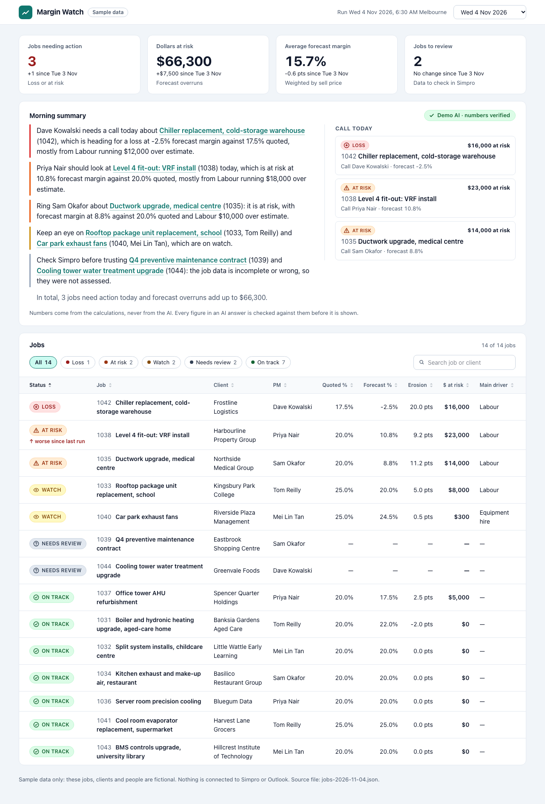
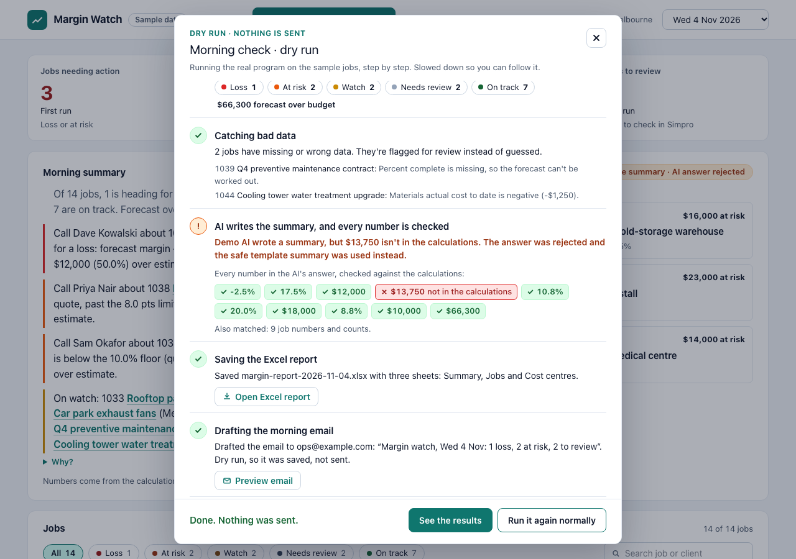

# Margin Watch

**Every morning, Margin Watch checks which jobs are losing money and tells the ops manager in plain English.** It reads job costing data for a commercial air-conditioning contractor, works out each job's quoted and forecast margin in code, and flags the jobs that are slipping (or whose data is wrong). It then writes an Excel report, drafts the morning email and shows everything on a dashboard.

> **Sample data only.** All 14 jobs, clients and people are made up. The data is *shaped like* Simpro and the email is *shaped like* a Microsoft Graph request, but nothing connects to Simpro, Outlook or any paid AI service, and no email is ever sent.



## Quickstart

You need [uv](https://docs.astral.sh/uv/) and Node.js 20+.

```bash
make demo
```

This runs both sample mornings (3 Nov with a deliberately bad AI answer, 4 Nov with a verified one), builds the dashboard and serves it at **http://localhost:4173**. It also prints where the Excel report and the email preview are. Stop it with Ctrl+C.

**Press "Run this morning's check"** in the top bar to watch a real dry run step by step: reading the jobs, doing the maths, catching bad data, the AI writing the summary while every number is checked, saving the Excel report and drafting the email. Nothing is sent. "Try it with a made-up AI number" shows the check rejecting an invented figure, live. `make demo-fresh` starts from an empty dashboard instead.



The button is served by a small local helper (`margin-watch serve`, listening on 127.0.0.1 only, offline demo AI only). A static copy of the dashboard (`npm run sync-runs && npm run build`) works without it, just without the button.

Other commands: `make test` (every check), `make clean` (remove generated files). To run one morning yourself:

```bash
cd agent && uv run margin-watch run --source ../data/sample/jobs-2026-11-04.json --ai demo
```

## What it does each morning

1. **Reads the jobs**: quoted price, budget per cost centre (labour, materials, subcontractors, equipment hire), spend so far and percent complete.
2. **Does the maths in code**: quoted margin, forecast margin at the current burn rate, how many points it has slipped, dollars at risk, and the cost centre driving it. See [the formulas](docs/spec.md#formulas).
3. **Gives every job a status**: Loss, At risk, Watch, On track, or **Needs review** when the data is missing or impossible. It never guesses.
4. **Writes** `output/margin-report-<date>.xlsx`, the email draft `output/email/graph-sendmail-<date>.json` (plus an HTML preview), and `output/runs/<date>.json` for the dashboard.
5. **Writes a short summary** with an AI model and checks every number in it.

## How the AI is kept honest

- **Code does the maths.** Python calculates every dollar, percentage and point, then formats each one as a string ("$12,000", "-2.5%", "20.0 pts").
- **The model only writes words.** It gets those strings through a tool (`get_job_facts`) and is told to quote them exactly and never calculate, round or estimate ([system prompt](prompts/summary_system.md)).
- **Every number is verified.** A validator pulls every number out of the model's answer and checks it against the calculated facts. One invented or re-rounded number ("$13,750", or "6%" when the fact is "6.2%") and the whole answer is rejected.
- **A rejected answer falls back to a template** written by code, and the dashboard and email say so: "Template summary · AI answer rejected", with a "Why?" listing the rejected number.

The tests that prove it: [validator](agent/tests/test_facts_validate.py), [demo model and fallbacks](agent/tests/test_demo_loop.py), [Claude client](agent/tests/test_anthropic_client.py), [local model client](agent/tests/test_local_client.py).

## AI providers

Set with `--ai` or `MARGIN_WATCH_AI` (in `agent/.env`):

| Value | What writes the summary | Needs |
|---|---|---|
| `demo` (default) | The **built-in demo AI**. It runs the real tool-use loop and the real validator offline, but its wording is scripted. It is always labelled "Demo AI", never Claude. | nothing |
| `demo-bad` | The demo AI with one invented number, to show the validator rejecting it. | nothing |
| `local` | A local model server such as LM Studio (`LOCAL_LLM_URL`, `LOCAL_LLM_MODEL`). | a running local server |
| `claude` | Claude via the Anthropic API (`MARGIN_WATCH_MODEL`, default `claude-sonnet-5-5`). | `ANTHROPIC_API_KEY` |
| `off` | The template summary only. | nothing |

If `local` or `claude` is unavailable (no key, unreachable, timeout, error), the run still succeeds with the template and records why. `local` and `claude` are implemented and tested with fakes but were never called for real in this build.

## How this was built

- **Acceptance criteria first.** Every behaviour is written down in [docs/acceptance-criteria.md](docs/acceptance-criteria.md) as `AC-NN` with concrete numbers, for example *AC-10: a 9.99% forecast margin is At risk, exactly 10% is On track*.
- **Tests from the criteria.** Each test carries its AC ID in its name (`test_ac10_…`, `test('AC-81 …')`) and was run red before any code existed.
- **Tests are then frozen.** After review, each phase's tests were committed and tagged `tests-approved-2`, `-4`, `-5`, `-6`, `-7` and `-8`. A hook blocks edits to committed tests, and `scripts/check_frozen_tests.py` proves none changed since their tag.
- **Traceability is checked.** `scripts/check_test_integrity.py` fails if any AC has no test, any test has no AC, or any test is skipped. 104 ACs, 205 Python tests, 32 unit and 21 browser tests (including accessibility checks with axe and an end-to-end run of the real local helper).
- Decisions are logged in [docs/decisions.md](docs/decisions.md) and phase-by-phase progress in [docs/progress.md](docs/progress.md).

## From prototype to production

- **`SimproSource`**: read jobs and cost centres from the Simpro REST API (OAuth 2.0 client credentials per company), and use Simpro webhooks to re-run when a job changes. It plugs in behind the same `JobSource` interface as the sample file.
- **`GraphMailer`**: send the same `sendMail` body through Microsoft Graph. Register an app in Entra ID and either use delegated `Mail.Send` (sends as the signed-in user) or the application permission with admin consent to send from a shared mailbox such as ops@. The payload is already in Graph's format, so this is configuration, not a rewrite.
- **Claude**: set `MARGIN_WATCH_AI=claude` and `ANTHROPIC_API_KEY`. The same validator still checks every number.
- **Schedule it**: [docs/scheduling.md](docs/scheduling.md) has a cron line and a Windows Task Scheduler task for 6:30 AM Melbourne time.

## Repository layout

`agent/` Python package (including the `serve` helper) and tests · `dashboard/` SvelteKit dashboard and tests · `config/` thresholds and settings · `data/sample/` the fictional jobs · `prompts/` the model's system prompt · `docs/` spec, acceptance criteria, decisions, progress, scheduling, QA checklist and Loom script · `output/` generated files (git-ignored).
